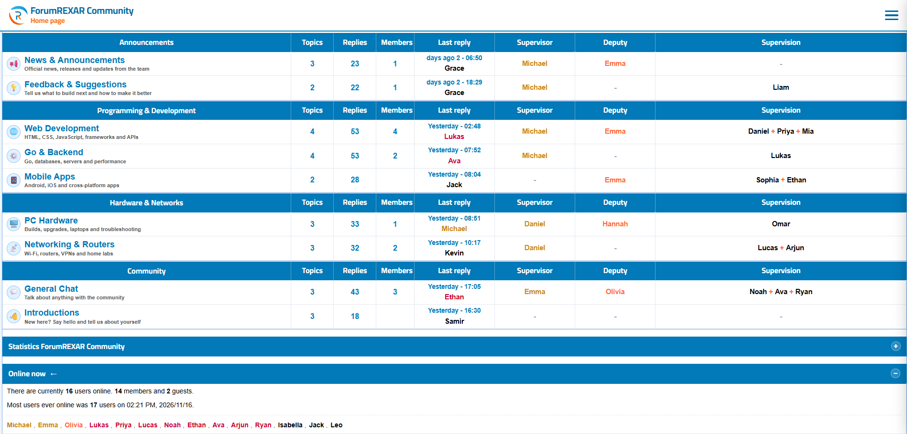
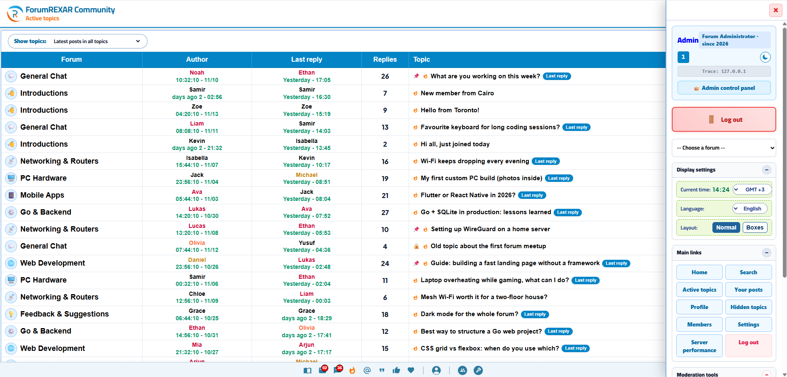
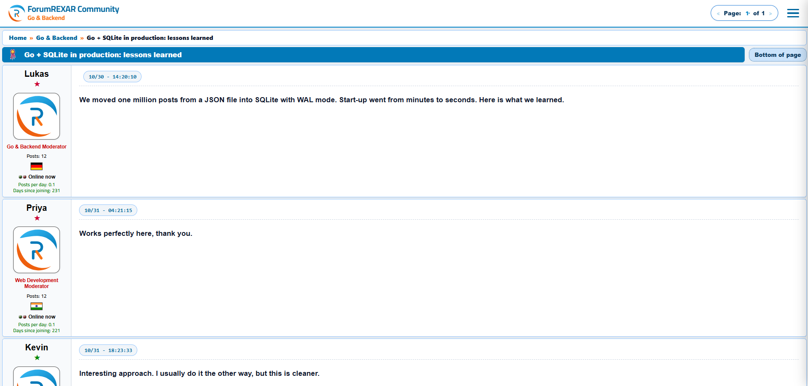
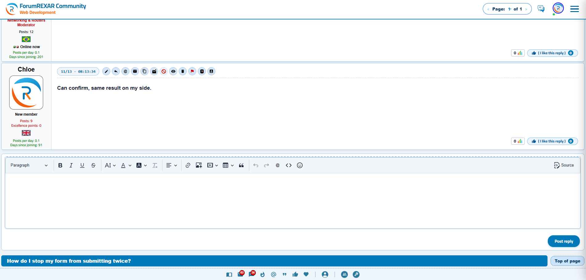
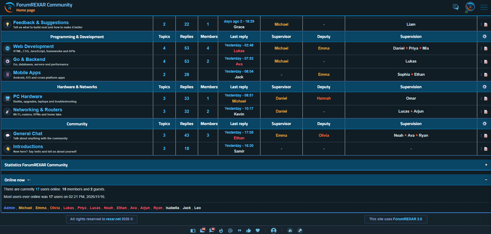
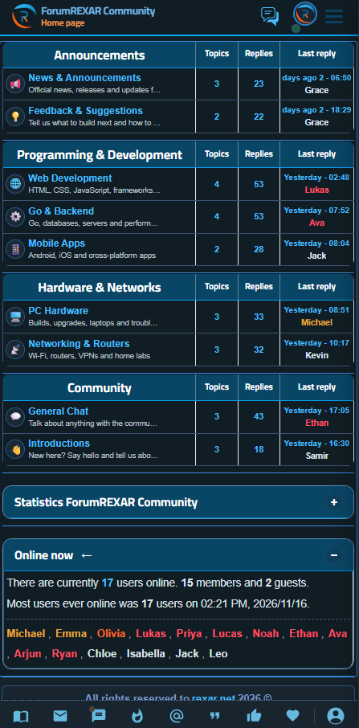
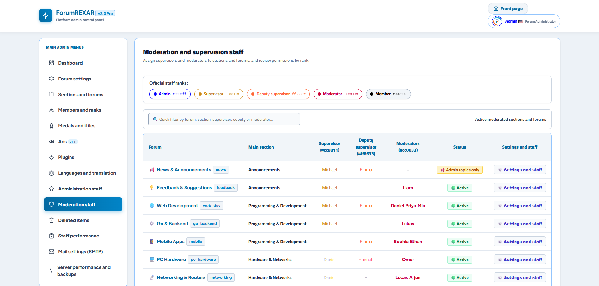

# ForumREXAR

[](https://hub.docker.com/r/forumrexar/forumrexar)
[](https://hub.docker.com/r/forumrexar/forumrexar)
[](https://hub.docker.com/r/forumrexar/forumrexar/tags)

**A self-hosted forum engine that brings back structured, classic forums — with the real-time feel of modern community apps.**

ForumREXAR is written in Go and ships as a single Docker image. Posts are stored in an embedded SQLite database, so there is no external database, cache server or search service to set up. It speaks many languages, flips its whole layout between right-to-left and left-to-right, and can be extended with safe, declarative XML plugins.

- **Community and live demo:** https://forum.rexar.net
- **Website:** https://rexar.net
- **Docker image:** [`forumrexar/forumrexar`](https://hub.docker.com/r/forumrexar/forumrexar) (amd64 and arm64)

## Screenshots

**Home page:** categories, forums, staff for each forum, and who is online.



**Active topics,** with the side menu: language, layout, and the dark mode button in the member card.



**A topic,** with the writer cards and staff titles.



**Moderation tools and the reply editor.**



**Dark mode,** on computers and phones.

<p> </p>

**Control panel:** supervisors, deputies and moderators for each forum.



---

## Features

### Community
- Categories, forums and topics in the classic forum layout, with pinned, featured, locked and hidden topics.
- A per-member choice between the classic forum list and a boxed layout of the forums.
- Quick reply with a full rich-text editor, quotes, @mentions, likes and topic follow.
- **Drafts:** what you type in a topic, reply, edit or private message is saved in your browser, and you are asked before leaving a page with unsent text.
- **Dark mode:** a moon button in the member card turns the forum dark, on computers and phones, keeping the colours members chose in their posts readable. The choice is saved with the member's account.
- Private messages with inbox, outbox and trash.
- A multi-room **live chat**.
- Member profiles, medals, titles, post styles and name-change requests.
- **Fast Arabic-aware search** for members: an embedded full-text index that ignores diacritics and hamza forms and finds words with or without the article (searching a million posts takes about 50 ms).
- **Link cards:** a link written alone on its line shows as a card with the page picture, title and description (GitHub repositories included). Pages are read once in the background with strict safety limits, and the director can turn cards off. Links to other sites open in a new tab.

### Real-time engagement
- Instant notifications for replies in followed topics, mentions, quotes, likes and private messages, pushed to the browser as they happen.
- Unread counters in the bottom bar, a floating alert and optional notification sounds.
- **Phone notifications (Web Push):** members turn them on per device and choose which kinds they get; they arrive even with the forum closed, on Android, iPhone (added to the home screen) and computers. No app store and no third-party account needed.

### Moderation
- Directors, deputies, category supervisors, their deputies and forum moderators, each limited to the forums they are assigned to.
- Pin, lock, hide, delete and restore topics and replies, with a trash for deleted items.
- Moderation messages sent in the forum's name, member reports and a complaints box per forum.
- Penalties with a history, and a full change history for every topic.

### Languages and direction
- Every page, email, chat message and notice can be translated.
- The whole layout switches between **RTL** and **LTR** with the language.
- Language packs are single **XML files**: export one from the control panel, translate it, and share it — it imports in one click.
- Visitors and members can pick their language when the director allows it.

### Plugins
- A plugin is one **XML file** — no JavaScript or Go code. You declare what it shows and where, and the forum validates it and renders it safely.
- Hooks across the home page, forums, topics and profiles, built-in data sources, settings forms and themes.
- See [docs/plugins.md](docs/plugins.md) and the [examples](plugins/examples).

### Under the hood
- Go backend, single binary, multi-architecture Docker image (amd64, arm64).
- Posts in an embedded pure-Go SQLite database (WAL mode); no PostgreSQL, MySQL or Redis.
- Hashed passwords, signed sessions, login rate limiting, a connection log and a login-attempts log for every member.
- Built-in backups from the control panel.

---

## Quick install

On a fresh **Ubuntu** or **Debian** server (amd64 or arm64):

```bash
curl -sSL https://forum.rexar.net/cdn/2026/install.sh | sudo bash
```

The forum starts on port **38980**. Open `http://YOUR-SERVER-IP:38980` and the setup wizard will guide you.

With your own domain and a free SSL certificate (Nginx + Let's Encrypt are set up for you):

```bash
curl -sSL https://forum.rexar.net/cdn/2026/install.sh | sudo REXAR_DOMAIN=forum.example.com REXAR_EMAIL=you@example.com bash
```

### Docker Compose

Prefer to do it yourself? Use the [docker-compose.yml](docker-compose.yml) in this repository:

```bash
mkdir forumrexar && cd forumrexar
curl -sSLO https://raw.githubusercontent.com/rexarsystems/ForumREXAR/main/docker-compose.yml
docker compose up -d
```

### Updating

```bash
cd /opt/forumrexar
docker compose pull && docker compose up -d --force-recreate
```

Your data lives in the `data` and `uploads` folders next to `docker-compose.yml` and is kept across updates.

More details: [docs/installation.md](docs/installation.md).

---

## Translating ForumREXAR

1. In the control panel open **Languages** and export a pack (or start from [languages/en.xml](languages/en.xml)).
2. Translate the `<text>` of each phrase; keep `<ar>` as it is.
3. Import your file in the control panel, then share it with the community.

Full rules: [docs/languages.md](docs/languages.md).

## Writing a plugin

Start with the five-minute example in [docs/plugins.md](docs/plugins.md), or open one of the [example plugins](plugins/examples) and change it.

---

## Feedback and support

- Bugs and ideas: [open an issue](../../issues/new/choose).
- Questions and discussion: https://forum.rexar.net

## License

ForumREXAR is **free to use** on your own servers. The forum engine is **closed source** — this repository holds its documentation, installer, language packs and plugin examples.

The language packs and plugin examples in this repository may be freely used, changed and shared.

© 2026 rexar.net — all other rights reserved.
